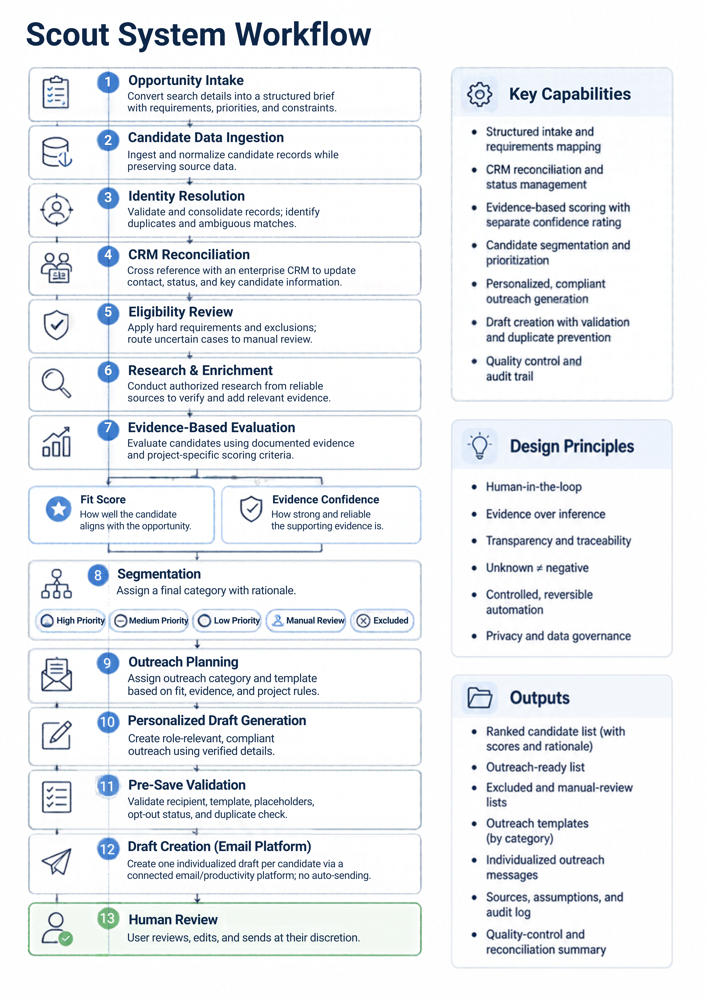

# Scout — AI Talent Sourcing & Workflow Agent

**An end-to-end, human-in-the-loop AI workflow for talent sourcing, candidate evaluation, research, outreach, and workflow automation.**

Scout began as an experiment to solve a practical business problem: talent sourcing involved large amounts of repetitive research, candidate evaluation, data reconciliation, outreach preparation, and quality control across disconnected systems.

I designed Scout to bring those steps into one structured AI-assisted workflow while keeping consequential decisions reviewable by a human.

> **Note:** This repository is a sanitized case study of the system architecture, design decisions, and development process. No confidential employer, client, candidate, or proprietary production data is included.
---
## The Problem
Traditional talent sourcing workflows often require a professional to move repeatedly between:
- role and search requirements
- candidate datasets
- public research sources
- internal CRM records
- scoring and prioritization
- outreach templates
- email
- spreadsheets and reporting

This creates several problems:
- repetitive manual research
- inconsistent candidate evaluation
- information scattered across systems
- difficulty distinguishing verified facts from inference
- manual personalization at scale
- duplicate or outdated records
- risk of cross-record data errors
- significant time spent preparing rather than evaluating

I wanted to test whether generative AI could manage much of this operational complexity without removing human judgment from important decisions.

---
## The Solution
Scout is a modular AI agent that turns a search brief and candidate dataset into an evidence-based recruiting workflow.

At a high level, Scout can:
1. Structure an opportunity into defined requirements and evaluation criteria
2. Ingest and normalize candidate records
3. Reconcile records against an enterprise CRM
4. Apply hard requirements and exclusions
5. Research and verify relevant information when authorized
6. Score eligible candidates using documented evidence
7. Assign a separate evidence-confidence rating
8. Segment candidates for prioritization or human review
9. Generate contextual outreach
10. Classify responses and prepare appropriate follow-up
11. Create validated email drafts through a connected productivity platform
12. Produce structured spreadsheet/CSV outputs and audit logs
13. Perform quality-control and reconciliation checks

The system is intentionally designed around **human review, evidence traceability, and controlled automation** rather than fully autonomous decision-making.

---
## System Architecture

```text
          Opportunity / Search Requirements
                        │
                        ▼
               Structured Intake
                        │
                        ▼
              Candidate Data Ingestion
                        │
                        ▼
              Identity + Data Resolution
                        │
                        ▼
                 CRM Reconciliation
                        │
                        ▼
        Hard Requirements / Exclusions
                        │
                        ▼
         Authorized Research + Enrichment
                        │
                        ▼
          Evidence-Based Fit Evaluation
                 │                │
                 ▼                ▼
            Fit Score      Evidence Confidence
                 │                │
                 └───────┬────────┘
                         ▼
                    Segmentation
                         │
          ┌──────────────┼──────────────┐
          ▼              ▼              ▼
     Prioritize     Manual Review     Exclude
          │
          ▼
      Outreach Category
          │
          ▼
    Personalized Drafting
          │
          ▼
      Pre-Save Validation
          │
          ▼
     Email Draft Creation
          │
          ▼
         Human Review
```

---

## Agent Modes
Rather than asking one prompt to perform every task, I separated the workflow into purpose-specific operating modes.

### SOURCE_AND_RANK
Ingests candidate data, evaluates eligibility, conducts authorized research, scores candidates, and creates structured outputs.

### CRM_RECONCILE
Cross-references source records against an enterprise CRM before final evaluation so updated contact/status information can influence downstream actions.

### BUILD_TEMPLATES
Creates or applies outreach templates based on candidate categories and approved messaging rules.

### OUTBOUND_DRAFTS
Validates candidate/template mappings and prepares individualized email drafts through a connected email platform.

### CLASSIFY_REPLY
Analyzes incoming responses and assigns an operational category.

### FOLLOW_UP_DRAFT
Generates an appropriate response based on the classification, verified information, and conversation context.

---

## Evidence-Aware AI
One of the core design decisions was separating **candidate fit** from **confidence in the evidence supporting that fit**.

A candidate can therefore have:
> High predicted fit + Low evidence confidence
rather than being treated automatically as a high-confidence recommendation.

Scout distinguishes among:
- verified information
- probable information
- unverified information
- missing information
- inference

Missing information is treated as **unknown**, rather than automatically positive or negative.
This approach helps reduce overconfidence and makes uncertainty visible to the human reviewing the output.

---
## Human-in-the-Loop Design
Scout is intentionally not a fully autonomous recruiting system.

The workflow routes ambiguous or consequential cases to **Manual Review**, including situations involving:

- ambiguous identity matches
- conflicting data
- uncertain eligibility requirements
- unsupported negative findings
- incomplete evidence
- CRM record ambiguity

The system is designed to support professional judgment rather than replace it.

---
## Scoring Framework

Eligible candidates can be evaluated using configurable weighted criteria such as:
- professional and credential alignment
- geographic relevance
- opportunity/work-style alignment
- career timing
- documented transition or openness signals
- differentiating experience

Hard requirements are evaluated separately from soft-fit scoring.
A high soft-fit score cannot override a verified hard-requirement failure.
Scoring weights can be customized by project.

---

## CRM Reconciliation
A key addition to Scout was integrating CRM reconciliation into the workflow **before final candidate scoring and outreach**.

The agent attempts to identify matching internal records, reconcile selected fields, and maintain the source history of changed information.

Examples include:
- contact information
- current location
- professional status
- relevant credentials
- prior interactions
- opt-out / do-not-contact status

Ambiguous matches are not guessed. They are routed to human review.
This design prevents outdated external data from automatically overriding more recent verified internal information.

---

## Outreach & Response Intelligence
Scout extends beyond sourcing into communication workflow support.

### Outreach Generation
Messages are generated using:
- verified professional relevance
- approved opportunity information
- defined tone and messaging constraints
- controlled personalization

The system intentionally avoids generating personalization based on sensitive personal information.

### Response Classification
Incoming responses can be classified into operational categories such as:
- interested
- passive
- not interested
- not now
- asking for information
- referral
- wrong contact

Each category triggers a different recommended follow-up strategy.
This turns the workflow from a one-time sourcing task into a basic AI-supported communication lifecycle.

---

## Controlled Email Automation
Scout can interact with a connected enterprise productivity platform to create drafts.
Automation stops at the **draft stage by default**.
Before a draft is created, Scout validates:
- correct recipient
- template match
- required fields
- personalization source
- restricted information
- opt-out status
- duplicate status
- unresolved placeholders

Each individual record is processed independently so one failure does not stop an entire batch.
The user reviews messages before sending.

---

## Duplicate Prevention & Idempotency
Automating communication introduced another problem: preventing the system from creating duplicate drafts when a workflow is rerun.
Scout therefore tracks a compound action key using concepts such as:

```text
Campaign
+
Candidate
+
Template
+
Template Version
```

Completed actions can be logged so repeated execution does not automatically recreate the same draft.
This introduced an idempotency pattern into the agent workflow rather than relying solely on conversational memory.

---

## Quality Control
Quality control is treated as part of the workflow rather than a final manual cleanup step.
Checks include:
- source-record reconciliation
- duplicate identification
- identity validation
- hard-requirement validation
- score reconciliation
- evidence-confidence review
- unsupported-claim auditing
- contact validation
- candidate-to-message alignment
- placeholder validation
- confidentiality checks
- duplicate-draft prevention
- structured-output validation

The agent also records assumptions and unresolved data gaps instead of silently filling them.

---

## Error Handling
Scout uses record-level error states so isolated failures do not stop batch processing.
Examples include:

```text
MISSING_REQUIRED_FIELD
INVALID_CONTACT
TEMPLATE_NOT_FOUND
DUPLICATE_TEMPLATE_LABEL
UNRESOLVED_PLACEHOLDER
OPTED_OUT
POSSIBLE_DUPLICATE
ACTION_FAILED
AMBIGUOUS_MATCH
FACTS_INSUFFICIENT
```

Failed records are surfaced for correction or human review while valid records continue through the workflow.

---

## Testing Strategy

Before production use, the workflow was tested using fictional records designed to trigger both successful and failure states.
Acceptance tests included scenarios such as:
- correct template matching
- candidate-specific personalization
- opt-out suppression
- missing-template handling
- duplicate-action prevention
- correct draft creation
- verification that messages were not automatically sent

I used these tests to identify workflow edge cases and revise instructions, validation rules, and error handling.

---

## Project Evolution
Scout evolved through several iterations.

### Phase 1 — AI Sourcing Assistant
Initial experimentation with generative AI for candidate sourcing, research, prioritization, and outreach.

### Phase 2 — Structured Agent
Moved from individual prompts toward reusable instructions, structured inputs, scoring logic, evidence standards, and standardized outputs.

### Phase 3 — Workflow Expansion
Added outreach categorization, response classification, follow-up logic, and quality-control standards.

### Phase 4 — Systems Integration
Added CRM reconciliation and productivity-suite connectivity to bridge AI reasoning with existing business systems.

### Phase 5 — Unified Workflow
Consolidated previously separate sourcing and communication workflows into one modular, human-reviewed AI agent.

---

## My Role
I conceived and designed Scout based on problems I experienced firsthand in talent acquisition workflows.

My work included:
- problem identification and workflow analysis
- use-case definition
- AI product and agent design
- prompt and instruction architecture
- knowledge-base design
- scoring-framework development
- evidence and confidence methodology
- workflow sequencing
- CRM reconciliation logic
- connector workflow design
- human-in-the-loop controls
- privacy and data-handling rules
- error-state design
- quality-control framework
- acceptance-test design
- iterative testing and refinement
- implementation into real business workflows
- user education and adoption

This project was built from the perspective of a business operator learning how to use AI to redesign real workflows—not as a traditional software-engineering exercise.

---

## Key Design Principles

### Evidence over inference
Important outputs should be traceable to information that supports them.

### Unknown ≠ negative
Missing information should remain missing rather than being silently interpreted.

### Confidence matters
Model output should communicate uncertainty, not just conclusions.

### Humans handle ambiguity
Consequential or uncertain cases should be escalated rather than guessed.

### Automate reversible actions first
Draft creation is automated; sending remains deliberate.

### Validate before acting
AI-generated content is checked against the same record that triggered the action.

### Fail locally
One bad record should not halt an otherwise valid batch.

### Preserve an audit trail
Original data, modifications, assumptions, and sources should remain traceable.

---

## What I Learned
Building Scout changed how I think about applied AI.

The hardest part of AI implementation is rarely writing a single strong prompt. The challenge is designing the system around the model:

- What information can it trust?
- What happens when information conflicts?
- What should the AI infer?
- What should it refuse to infer?
- Which actions can safely be automated?
- Where should a human remain involved?
- How should uncertainty appear in the output?
- How do you prevent one record's information from leaking into another?
- What happens when part of a workflow fails?
- How do you know an automated action already occurred?

Those questions became as important to the project as the model itself.

Scout ultimately became an exercise in **AI workflow architecture, human-centered automation, data governance, and business process redesign**.

---

## Tools & Concepts

**AI / LLM**
- Generative AI
- Claude
- Custom GPT experimentation
- Prompt and instruction engineering
- Knowledge-grounded workflows
- Structured output

**Business Systems**
- Enterprise CRM integration
- Enterprise email/productivity connector
- Structured CSV/Excel workflows

**AI Product Concepts**
- Agentic workflows
- Human-in-the-loop systems
- Evidence grounding
- Confidence scoring
- Retrieval and reconciliation
- Classification
- Structured generation
- Workflow orchestration
- Idempotency
- Error handling
- Acceptance testing
- AI governance

---

## Privacy
This repository contains no real candidate records, confidential employer information, client information, private prompts, or production credentials.

All examples and diagrams are generalized or use synthetic data.
